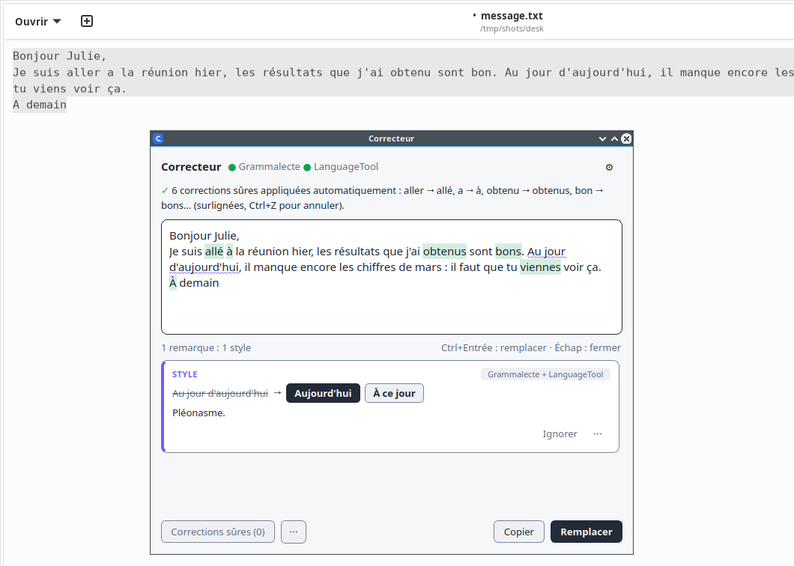
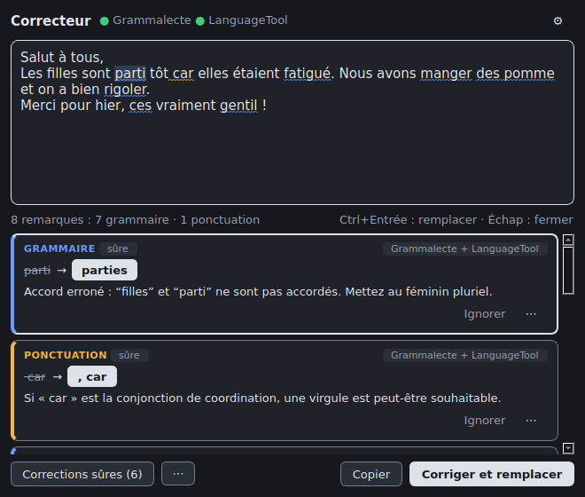
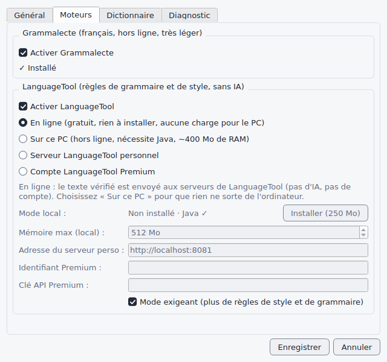
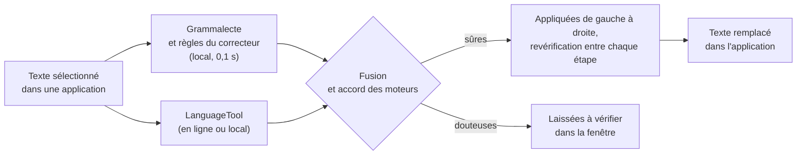

<div align="center">


# Correcteur

Correcteur d'orthographe et de grammaire pour Windows et Linux.<br>
On sélectionne un texte dans une application (navigateur, Word, Discord…), on appuie sur
<kbd>Ctrl</kbd> + <kbd>Alt</kbd> + <kbd>X</kbd> et il est remplacé par sa version corrigée.
<kbd>Ctrl</kbd> + <kbd>Alt</kbd> + <kbd>C</kbd> ouvre plutôt une fenêtre pour voir chaque faute avant de corriger.

[](https://github.com/mateo-brl/correcteur_orthographe/actions/workflows/tests.yml?query=branch%3Amaster)


[Installer](#installation) · [Utiliser](#utilisation) · [Limites](#limites-connues) · [Confidentialité](#moteurs-et-confidentialité) · [Comment ça marche](#comment-ça-marche) · [Tests](#tests-et-qualité)

</div>

<br>

## Aperçu

Trois phrases passées à la correction express, telles que le correcteur les rend :

```diff
- Je suis aller a la réunion hier, les résultats que j'ai obtenu sont bon.
+ Je suis allé à la réunion hier, les résultats que j'ai obtenus sont bons.

- Il faut que tu viens voir ça, les enfant était ravis !
+ Il faut que tu viennes voir ça, les enfants étaient ravis !

- Les filles sont parti tôt car elles étaient fatigué. Nous avons manger des pomme et on a bien rigoler.
+ Les filles sont parties tôt, car elles étaient fatiguées. Nous avons mangé des pommes et on a bien rigolé.
```

La fenêtre de correction, ouverte par <kbd>Ctrl</kbd> + <kbd>Alt</kbd> + <kbd>C</kbd> :

<table>
  <tr>
    <td></td>
    <td></td>
  </tr>
  <tr>
    <td align="center"><sub>Thème clair</sub></td>
    <td align="center"><sub>Thème sombre (suit le système)</sub></td>
  </tr>
</table>

## Pourquoi Correcteur

Deux moteurs tournent en même temps, [Grammalecte](https://grammalecte.net) sur le PC et
[LanguageTool](https://languagetool.org), et ils ne repèrent pas les mêmes fautes. Quand ils proposent la même
correction, elle est appliquée d'office ; sinon elle reste à vérifier. C'est pour ça que la correction express ne
change pas « tache » en « tâche » : rien ne dit lequel des deux mots était voulu.

Un troisième moteur, propre au correcteur, rattrape ce que les deux autres laissent passer ou corrigent mal :
« Il ces levé » devient « Il s'est levé » (Grammalecte proposait « sait » et « levés »), « Mes parents son
partis » devient « sont partis » (et non « son parti »), « Il faut que je fait » devient « fasse », « Je ne sais
pas ou il est » devient « où », « Elle s'est assit » devient « assise », « fesait » devient « faisait ». Ce sont
des règles écrites à la main, chacune mesurée sur plusieurs milliers de phrases avant d'être appliquée d'office.

Il n'y a pas d'IA, seulement des règles de grammaire. Grammalecte fonctionne sans Internet, et LanguageTool peut
tourner sur le PC si on ne veut rien envoyer en ligne. Sous Linux, l'application occupe environ 130 Mo de RAM et
n'utilise pas le processeur au repos.

La typographie est réglée pour l'écrit courant : pas de remarque sur les apostrophes courbes ou les espaces
insécables dans un message, et « stp » ou « rdv » passent. Un mode strict existe pour les documents soignés.

## Installation

### Windows

1. Téléchargez **`Correcteur-x.y.z-installation-windows.exe`** dans les
   [versions publiées](https://github.com/mateo-brl/correcteur_orthographe/releases).
2. Lancez-le. Il n'a pas besoin des droits administrateur.

> [!NOTE]
> Le programme n'est pas signé, donc Windows peut afficher « Windows a protégé votre ordinateur ».
> Cliquez sur *Informations complémentaires* puis *Exécuter quand même*.

Il existe aussi une version portable, **`Correcteur-x.y.z-windows-portable.zip`** : décompressez-la et lancez
`Correcteur.exe`. Elle range ses paramètres, son dictionnaire et ses journaux dans un dossier `Données` à côté
d'elle ; supprimez le fichier `portable.txt` pour qu'elle utilise ceux de la version installée.

Pour désinstaller : *Paramètres › Applications*. Le désinstallateur demande s'il faut aussi supprimer vos
paramètres, votre dictionnaire et les moteurs téléchargés (le mode LanguageTool « Sur ce PC » occupe près de
400 Mo).

### Linux

Téléchargez **`Correcteur-x.y.z-linux-x86_64.tar.gz`** au même endroit, puis :

```bash
tar xzf Correcteur-x.y.z-linux-x86_64.tar.gz
./Correcteur/installer-linux.sh
```

Le script installe tout dans `~/.local`, sans `sudo`. Il ajoute le correcteur au menu des applications et au
démarrage de session, puis le lance. Pour une mise à jour, relancez-le depuis la nouvelle archive : il arrête
l'ancienne version et la remplace. `./Correcteur/installer-linux.sh --desinstaller` retire tout, sauf vos
paramètres et votre dictionnaire.

| Session | Paquets utiles (Debian / Ubuntu) |
|---|---|
| X11 | `libxcb-cursor0` (souvent déjà présent) |
| Wayland | `wl-clipboard`, plus `wtype` (Sway, KDE) ou `ydotool` (GNOME) pour le remplacement automatique |

<details>
<summary>Wayland : les raccourcis</summary>

<br>

Sous Wayland, une application n'a pas le droit d'écouter le clavier globalement. Les raccourcis se déclarent donc
dans les paramètres du bureau, avec ces commandes :

| Raccourci | Commande |
|---|---|
| <kbd>Ctrl</kbd> + <kbd>Alt</kbd> + <kbd>C</kbd> | `correcteur selection` |
| <kbd>Ctrl</kbd> + <kbd>Alt</kbd> + <kbd>X</kbd> | `correcteur express` |

Sous GNOME, le script d'installation les crée lui-même, et `correcteur raccourcis-gnome` fait la même chose.
La commande transmet l'ordre à l'application déjà lancée, qui réagit aussitôt.

</details>

<details>
<summary>Depuis les sources</summary>

<br>

Il faut Python 3.10 ou plus récent.

```bash
git clone https://github.com/mateo-brl/correcteur_orthographe
cd correcteur_orthographe
./scripts/installer-linux.sh                                              # Linux
powershell -ExecutionPolicy Bypass -File scripts\installer-windows.ps1   # Windows
```

</details>

## Utilisation

| Raccourci (modifiable) | Action |
|---|---|
| <kbd>Ctrl</kbd> + <kbd>Alt</kbd> + <kbd>C</kbd> | Ouvre la fenêtre de correction sur le texte sélectionné |
| <kbd>Ctrl</kbd> + <kbd>Alt</kbd> + <kbd>X</kbd> | Correction express : corrige directement le texte sélectionné |

À l'ouverture de la fenêtre, dès que les moteurs ont répondu, les corrections sûres sont appliquées d'office et
surlignées (un seul <kbd>Ctrl</kbd> + <kbd>Z</kbd> les annule). Les fautes douteuses restent soulignées, à corriger
d'un clic. Ce comportement se coupe dans les paramètres (« Corriger automatiquement les fautes sûres »).

Dans la fenêtre :

| Action | Effet |
|---|---|
| Clic sur un mot souligné | Suggestions, *Ignorer*, *Ajouter au dictionnaire* |
| Bouton *Corrections sûres* | Applique d'un coup tout ce qui est confirmé (un seul <kbd>Ctrl</kbd> + <kbd>Z</kbd> pour annuler) |
| <kbd>Ctrl</kbd> + <kbd>Entrée</kbd> ou *Remplacer* | Remplace le texte dans l'application d'origine. Avant la fin des vérifications, le bouton affiche *Vérification…* et le texte est figé : le correcteur attend les moteurs, applique les corrections sûres puis remplace. Tant que rien n'est corrigé, le bouton s'appelle *Corriger et remplacer*. Un texte inchangé n'est jamais recollé |
| <kbd>F8</kbd> / <kbd>Maj</kbd> + <kbd>F8</kbd> | Faute suivante / précédente, à partir du curseur |
| <kbd>F5</kbd> | Revérifie le texte (utile si la revérification pendant la frappe est coupée dans les paramètres) |
| <kbd>Alt</kbd> + <kbd>1</kbd> … <kbd>5</kbd> | Applique la suggestion n° 1 à 5 de la faute sélectionnée (ou sous le curseur) et passe à la suivante |
| <kbd>Échap</kbd> | Ferme la fenêtre et rend le presse-papiers d'origine |

Couleurs : 🔴 orthographe · 🔵 grammaire · 🟠 ponctuation · 🟣 style. Le texte reste modifiable et la vérification
suit la frappe.

Après une correction express, la notification indique les premières corrections faites (« aller → allé, a → à,
c'est → s'est… ») et le nombre de remarques laissées à vérifier. Si vous tapez, cliquez ou changez de fenêtre
pendant qu'elle se fait, rien n'est collé : la sélection a pu bouger, et le texte corrigé atterrirait ailleurs. Le
correcteur le dit, et vous rend votre presse-papiers. Sous Linux, le moindre geste compte : sous GNOME, un simple
mouvement de souris pendant la correction suffit pour qu'elle ne soit pas collée (relire la sélection ferait perdre
une touche, voir plus bas) ; sous X11, le correcteur attend une courte pause, relit la sélection, et colle si elle
n'a pas changé. Sans sélection, VS Code et Notepad++ copient la ligne entière : le correcteur le repère et
répond « Aucun texte sélectionné » au lieu de coller cette ligne au curseur. Sous Windows, ses messages s'affichent
dans une bulle à lui, visible même en mode « Ne pas déranger ».

Sous Windows, la mise en forme est gardée (gras, italique, liens, espaces insécables) quand l'application copie le
texte avec elle : Word, Outlook, les navigateurs, LibreOffice. Google Docs reçoit le texte seul : il recollait
sinon sa propre copie, sans les corrections.

L'icône dans la zone de notification donne accès à « Vérifier le presse-papiers », à une fenêtre vide où taper
ou coller un texte, et aux paramètres.

<details>
<summary>En ligne de commande</summary>

<br>

```bash
correcteur verifier "Il faut que tu viens demain."     # liste les fautes
correcteur verifier --json --fichier lettre.txt         # sortie JSON, pour des scripts
echo "Je vais a la plage ." | correcteur corriger       # applique les corrections sûres
correcteur corriger --tout < brouillon.txt              # applique toutes les premières suggestions
correcteur diagnostic                                    # état de l'installation
```

`--hors-ligne` n'utilise que les moteurs locaux (Grammalecte, et LanguageTool seulement en mode « serveur local »).
`-l` accepte `auto`, `fr` ou un code comme `en` ou `en-US` ; un code inconnu est refusé avant tout envoi. Avec
`--json`, les erreurs sortent aussi en JSON (`{"erreur": "..."}`). Codes de retour de `verifier` et `corriger` : 0 (aucune
faute, ou texte corrigé), 1 (fautes trouvées), 2 (erreur, fichier binaire compris), 3 (aucun moteur n'a pu vérifier le
texte : langue non gérée, moteur injoignable). Sous Windows, la commande s'appelle `correcteur-cli.exe` ; dans un tube,
sa sortie suit la page de code de la console (que lisent cmd, PowerShell 5, `findstr` et `more`), où « œ », « ’ » et
« … » deviennent « oe », « ' » et « ... ». L'option `--utf8` garde l'UTF-8, sans perte, pour un programme qui le lit.

</details>

## Limites connues

- Sous Linux, dans un terminal, le remplacement automatique échoue. Le correcteur envoie <kbd>Ctrl</kbd> +
  <kbd>V</kbd>, alors que les terminaux collent avec <kbd>Ctrl</kbd> + <kbd>Maj</kbd> + <kbd>V</kbd>. Sous Wayland, il ne peut pas savoir
  que le collage a échoué : la notification annonce quand même les corrections. Dans un terminal, ouvrez plutôt
  la fenêtre de correction, copiez le texte corrigé, puis collez-le avec <kbd>Ctrl</kbd> + <kbd>Maj</kbd> +
  <kbd>V</kbd>. Les terminaux qui ne copient pas avec <kbd>Ctrl</kbd> + <kbd>Inser</kbd> (kitty, Alacritty,
  xterm) ne donnent pas leur sélection : le correcteur répond « Aucun texte sélectionné ».
- Sous Wayland, le remplacement automatique passe par `wtype` ou `ydotool` (sous GNOME, uniquement `ydotool`). Si
  l'outil manque, le texte corrigé est seulement copié dans le presse-papiers et il faut le coller soi-même avec
  <kbd>Ctrl</kbd> + <kbd>V</kbd>.
- Sous Windows, le correcteur ne peut pas lire une fenêtre lancée en administrateur (Windows bloque les frappes
  simulées vers elle) : il le dit. Copiez le texte puis utilisez « Vérifier le presse-papiers », ou lancez aussi le
  correcteur en administrateur.
- Une image copiée par <kbd>Win</kbd> + <kbd>Maj</kbd> + <kbd>S</kbd> est remise dans le presse-papiers sans son
  format « fichier » : elle se colle toujours comme image, plus comme fichier dans l'Explorateur.
- Sous Wayland, le presse-papiers d'origine revient dans un seul format (l'outil `wl-copy` n'en sert qu'un) :
  l'image, ou les fichiers copiés pour le gestionnaire de fichiers, sinon le texte brut. Un texte mis en forme
  copié dans Writer revient sans sa mise en forme ; des fichiers copiés dans Fichiers se recollent dans Fichiers,
  plus dans un navigateur.
- Sous Wayland, tant que le renommage d'un fichier (<kbd>F2</kbd> dans Fichiers) ou la recherche de la vue d'ensemble
  de GNOME est ouvert, le presse-papiers ne répond pas : le correcteur le dit. Copiez le texte, puis utilisez
  « Vérifier le presse-papiers ».
- Dans Word et Outlook, corriger un paragraphe sélectionné avec sa marque de fin (tout le document, par exemple)
  peut laisser un paragraphe vide après lui.
- PowerShell 5 remplace les accents par « ? » dans le texte qu'il envoie à un programme par un tube
  (`"texte" | correcteur-cli corriger`) : passez le texte en argument, ou utilisez PowerShell 7.
- Les suggestions d'orthographe peuvent manquer le bon mot. Les fautes les plus fréquentes (« fesait », « malgrès »,
  « parmis ») ont leur correction dans le moteur du correcteur ; pour les autres, la bonne suggestion n'est pas
  toujours en tête.
- Sans LanguageTool, certaines fautes restent signalées sans être corrigées d'office, faute d'indice pour choisir :
  « Quels changement » (« Quel changement » ou « Quels changements » ?). D'autres ne sont pas signalées du tout hors
  ligne : « Je les ai vu » (« vus » ou « vues » ?).
- Le mode LanguageTool en ligne est limité à environ 20 vérifications par minute.

## Moteurs et confidentialité

| Moteur | Où il tourne | Coût pour le PC |
|---|---|---|
| Grammalecte | sur le PC, toujours | ~65 Mo de RAM |
| LanguageTool en ligne *(par défaut)* | serveurs de LanguageTool | aucun |
| LanguageTool sur ce PC *(option)* | sur le PC, hors ligne | Java 17+, ~400 Mo de RAM |

> [!IMPORTANT]
> En mode « en ligne », le texte vérifié est envoyé à l'API gratuite de LanguageTool (limitée à environ
> 20 vérifications par minute). Pour que rien ne sorte de l'ordinateur, choisissez « Sur ce PC » dans
> *Paramètres › Moteurs*, ou désactivez LanguageTool. Un compte LanguageTool Premium ou votre propre serveur
> fonctionnent aussi.

Le serveur LanguageTool local est lancé en priorité basse, avec une mémoire plafonnée (réglable). Il s'arrête avec
le correcteur, même en cas de fermeture brutale.

<p align="center"></p>

## Paramètres

Clic droit sur l'icône › *Paramètres* : langue (français, détection automatique, anglais, espagnol, allemand…),
typographie standard ou stricte, abréviations, raccourcis, lancement au démarrage, thème, dictionnaire personnel
et règles désactivées.

Les fichiers sont dans `%LOCALAPPDATA%\Correcteur` (Windows) ou `~/.config/Correcteur` (Linux) :
`parametres.json`, et `dictionnaire.txt` qui contient un mot par ligne et se modifie à la main.

## Comment ça marche



1. Le raccourci est capté par `RegisterHotKey` sous Windows et par `pynput` sous X11. Sous Wayland, c'est le
   bureau qui le gère.
2. Le correcteur lit le texte sélectionné. Sous X11, il prend la sélection primaire seulement si elle appartient
   à la fenêtre active. Sinon, et toujours sous Wayland (la sélection primaire peut y venir d'une autre fenêtre),
   il simule <kbd>Ctrl</kbd> + <kbd>Inser</kbd>, la copie que comprennent aussi les terminaux :
   <kbd>Ctrl</kbd> + <kbd>C</kbd> y interromprait le programme en cours. Sous Windows aussi, d'abord
   <kbd>Ctrl</kbd> + <kbd>Inser</kbd> (que Reverso et son double <kbd>Ctrl</kbd> + <kbd>C</kbd> ignorent), puis
   <kbd>Ctrl</kbd> + <kbd>C</kbd> si l'application ne le connaît pas, jamais dans un terminal (Windows Terminal,
   consoles, VS Code). Il remet ensuite le presse-papiers d'origine, images et fichiers compris sous Windows et sous
   Wayland, si personne n'a copié autre chose entre-temps (l'Explorateur, qui réécrit le même texte après un
   collage, ne compte pas). Sous Wayland, il attend pour cela une pause de frappe, jusqu'à une minute ; sans pause,
   la correction suivante reprend le contenu d'origine. Sous Windows, quand l'application a aussi copié le texte mis
   en forme (HTML), les corrections y sont reportées mot à mot sans toucher aux balises, et les deux versions sont
   collées. Pendant une correction express, le correcteur note les frappes et les clics sous Windows (Raw Input,
   qui reçoit une copie des évènements sans jamais les retarder) : s'il y en a eu, il ne colle rien. Sous Linux, il
   lit le compteur d'inactivité du bureau (GNOME, X11) juste avant de coller. Sous GNOME, si vous avez tapé, cliqué
   ou bougé la souris depuis la copie, il ne colle rien : wl-copy et wl-paste y prennent le focus clavier un
   instant, et relire la sélection pendant que vous tapez vous ferait perdre une touche. Sous X11, il attend une
   pause de 0,3 s (1,5 s au plus, pour que son <kbd>Ctrl</kbd> simulé ne se mêle pas à vos touches), recopie la
   sélection et ne colle que si elle n'a pas changé ; le compteur est relu juste avant le collage. Sans compteur
   (Wayland hors GNOME, où wl-copy ne prend pas le focus), la sélection est toujours relue avant le collage.
   Quand la sélection est une cellule de tableur copiée hors édition (LibreOffice Calc, Excel), le correcteur
   envoie <kbd>Échap</kbd> juste après la copie : Calc passe sinon en mode copie, où <kbd>Entrée</kbd> colle le
   presse-papiers du moment au lieu de valider la cellule.
   Un gestionnaire d'historique du presse-papiers (GPaste, Clipboard Indicator, Klipper) garde la trace du texte
   capturé et du texte corrigé, comme pour toute copie.
3. Les deux moteurs tournent en parallèle. Les résultats de Grammalecte s'affichent tout de suite, ceux de
   LanguageTool s'ajoutent dès qu'ils arrivent.
   Les règles du correcteur (`engines/regles.py`) passent dans le même temps que Grammalecte, avec son
   dictionnaire (nature, genre, nombre, temps de chaque mot) et son module de conjugaison. Une règle ne propose
   qu'une correction, et seulement quand le contexte l'impose : « Ils mange » devient « mangent » parce que
   « mangent » se prononce comme ce qui est écrit, mais « Ils prend » reste à vérifier (« Il prend » ou « Ils
   prennent » ?). Elles remplacent la remarque de Grammalecte sur le même mot et écartent, chez les deux moteurs,
   celles qu'elles savent fausses : dans « Ils se sont téléphoné », Grammalecte voudrait « téléphonés » ; dans
   « Je pense que le chat a la grippe », LanguageTool voudrait « à ». Leur coût est négligeable : 0,1 s pour
   170 000 caractères, quand Grammalecte en met plus de 60.
4. Une faute signalée par les deux moteurs devient une seule remarque, qui garde en mémoire leur accord.
5. Une correction est considérée comme sûre si les deux moteurs proposent la même, si c'est un accent
   (« ecole » → « école ») ou une ponctuation évidente.
   Quand Grammalecte est seul (hors ligne, ou LanguageTool injoignable), personne ne peut confirmer ses
   corrections de grammaire. Il n'applique alors que celles de règles vérifiées une à une sur des phrases
   réelles (à/a, c'est, ont, sont, subjonctif, participes passés…) : les autres tombent trop souvent sur le
   mauvais mot (« Mes parents son partis » deviendrait « son parti »). Il fait aussi une contre-épreuve : il
   applique la correction, revérifie la phrase, et ne la garde que si elle ne fait pas disparaître une autre
   lecture possible. « Ils on mangé » devient « Ils ont mangé », mais dans « les résultats que j'ai obtenu
   sont bon », « son bon » et « sont bons » font chacun disparaître l'autre faute : la phrase reste à
   vérifier dans la fenêtre.
   En ligne, la même contre-épreuve départage les deux moteurs quand ils ne sont pas d'accord. Dans « Tu à
   raison », Grammalecte veut « as » et LanguageTool « a ». Grammalecte resignale aussitôt « Tu a raison » :
   c'est « as » qui est appliqué. Dans « Mes parents son partis », seul LanguageTool propose « sont », et
   Grammalecte bute juste à côté sur « partis ». Corriger « son » le fait taire, donc « sont » est appliqué.
   Quand les deux corrections passent la contre-épreuve, ce sont deux lectures possibles, et rien n'est
   appliqué. Si LanguageTool est seul à voir une confusion d'homophones (« Je me suis fait mal a la main »), que
   c'est la seule remarque de la phrase et que Grammalecte n'y trouve rien, ni avant ni après la correction,
   elle est appliquée. Les tournures où « a » est le verbe (« il a l'air », « elle a toutes les chances ») et
   les règles de LanguageTool qui se trompaient sur le corpus de test sont écartées.
   Quelques corrections ne sont jamais appliquées d'office, même quand les deux moteurs sont d'accord. C'est le
   cas de l'accord du participe des verbes pronominaux : « nous nous sommes téléphoné » et « ils se sont
   téléphoné » sont justes. C'est aussi le cas de la conjugaison après « il faut que » et ses semblables : dans
   « Il faut que je fait », les deux moteurs proposent « fais », alors qu'il faut le subjonctif « fasse ».
6. Les corrections sûres s'appliquent en cascade. Dans « les enfant était ravis », les deux moteurs voudraient
   « ravi » (accord avec « était »), ce qui serait faux. Le correcteur corrige d'abord « enfants » et revérifie
   localement (c'est instantané). Il corrige ensuite « étaient », et « ravis » redevient juste. Dans une même
   phrase, il ne mélange jamais une correction vers le pluriel et une vers le singulier.
7. Pour remplacer le texte, il simule <kbd>Ctrl</kbd> + <kbd>V</kbd> dans la fenêtre d'origine.

<details>
<summary>Optimisations</summary>

<br>

- Grammalecte et les règles du correcteur sont préchargés au démarrage, et Grammalecte garde un cache par
  paragraphe : seul le paragraphe modifié est réanalysé.
- LanguageTool garde un cache et une connexion ouverte, et son client réseau est prêt dès le démarrage ; les longs
  textes sont découpés automatiquement.
- Le canal de commande s'ouvre dès le lancement, avant l'interface : un raccourci tapé pendant le démarrage attend
  que l'application soit prête.
- Pendant la frappe, seul Grammalecte est relancé tout de suite. LanguageTool attend une courte pause.
- En correction express, LanguageTool a 8 secondes pour répondre (réseau lent, serveur local qui démarre). Passé ce
  délai, Grammalecte corrige seul avec ses règles prudentes, et la réponse de LanguageTool, gardée en cache, sert à
  la correction suivante.
- La liste des remarques n'est reconstruite que si elle change réellement.
- Sous X11, les sélections sont lues et servies directement avec python-xlib, comme le fait `xclip`. Cela reste
  fiable quand l'application tourne en arrière-plan depuis des heures.

</details>

## Performances

Mesuré sous Linux, avec l'application empaquetée :

| Mesure | Valeur |
|---|---|
| Mémoire, application résidente avec Grammalecte préchargé | ~130 Mo |
| Processeur au repos | 0 % |
| Analyse Grammalecte d'un paragraphe | ~0,1 s |
| Correction express complète, LanguageTool en ligne compris | 1,5 à 3,5 s |
| Correction express hors ligne (Grammalecte seul) | ~0,1 s |
| Espace disque | ~160 Mo (dont la bibliothèque graphique Qt) |

## Tests et qualité

La CI lance plus de 950 tests sous Windows et Linux (Python 3.10 et 3.13) à chaque modification :

- moteurs, fusion, corrections sûres, correction en cascade, dictionnaire, paramètres ;
- banc d'essai (`tests/banc_fautes.py`) : plus de 220 fautes courantes qui doivent être corrigées d'office sans
  LanguageTool, et plus de 170 phrases justes ou ambiguës qui ne doivent pas bouger ; chaque règle du correcteur
  a ses propres tests, sur des phrases fautives et sur leurs voisines justes ;
- interface (fenêtre, soulignements, annulation, paramètres) ;
- tests « vrai bureau » sous Linux, sur un écran X11 virtuel : une vraie application tourne dans un autre
  processus, et le test y sélectionne du texte, le capture, lance la correction express, vérifie le remplacement,
  la restauration du presse-papiers et le raccourci global ;
- tests Windows : raccourcis `RegisterHotKey`, presse-papiers Unicode et HTML, sauvegarde et restauration,
  surveillance des frappes, registre ; et, sous Linux, le pont Windows sur un Windows simulé (collage refusé après
  une frappe, corrections en rafale, menu de l'icône, fenêtre lancée en administrateur). Le parcours complet sur
  un vrai bureau Windows est essayé à la main : version 0.1.11 sur Windows 11, 22 champs d'applications.

```bash
pip install -e ".[dev]"
python -m correcteur installer grammalecte --dossier vendor
python -m pytest                                                              # tests hors écran
xvfb-run -a env QT_QPA_PLATFORM=xcb XDG_SESSION_TYPE=x11 python -m pytest    # + tests « vrai bureau »
```

Tests optionnels : `CORRECTEUR_TESTS_RESEAU=1` (vraie API LanguageTool),
`CORRECTEUR_TEST_LT_DIR=…/LanguageTool-6.6` (serveur LanguageTool local).

Pour publier une version, on change le numéro dans `pyproject.toml` et `src/correcteur/__init__.py`, puis on
pousse sur master. La CI construit l'installateur Windows, la version portable et l'archive Linux, les teste, puis
crée le tag et la version sur GitHub. Pousser un tag `v…` à la main fonctionne aussi. Les versions 0.x sont
publiées comme pré-versions.

Les choix visuels de l'interface sont expliqués dans [DESIGN.md](DESIGN.md).

<details>
<summary>Structure du code</summary>

<br>

```
src/correcteur/
├── checker.py        orchestration, fusion des moteurs, corrections sûres et en cascade
├── engines/          Grammalecte, règles du correcteur (regles.py), LanguageTool (API + serveur local)
├── platform/         raccourcis, sélection et presse-papiers (Windows, X11, Wayland),
│                     instance unique, démarrage automatique
├── ui/               application Qt : icône, fenêtre de correction, paramètres
└── cli.py            ligne de commande
packaging/            PyInstaller, installateur Inno Setup, icônes
scripts/              installation Linux et Windows
tests/                tests unitaires, interface et intégration bureau
```

</details>

## Licence

Correcteur est distribué sous licence [GNU GPL v3 ou ultérieure](LICENSE). Ce choix est imposé par Grammalecte
(GPL v3), inclus dans les versions empaquetées. LanguageTool (LGPL) n'est pas inclus : il est téléchargé à part
si on active le serveur local. Chaque paquet contient le texte de la licence et un fichier `SOURCES.txt` qui
indique où trouver le code source de tout ce qu'il inclut.
